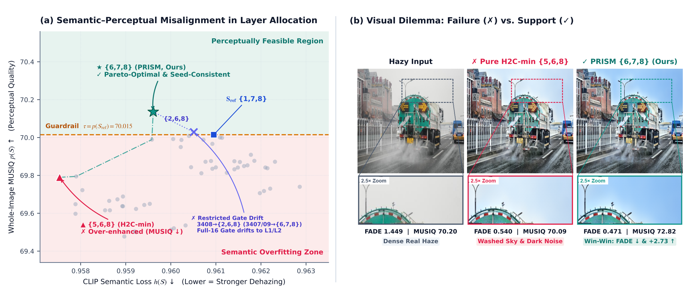
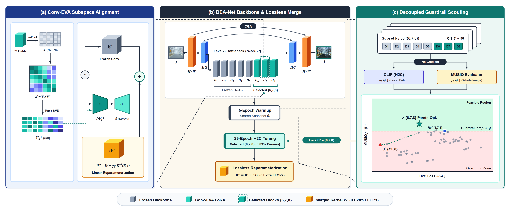
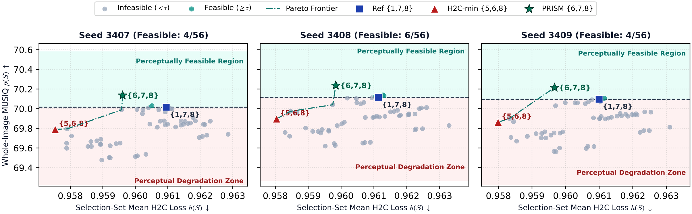
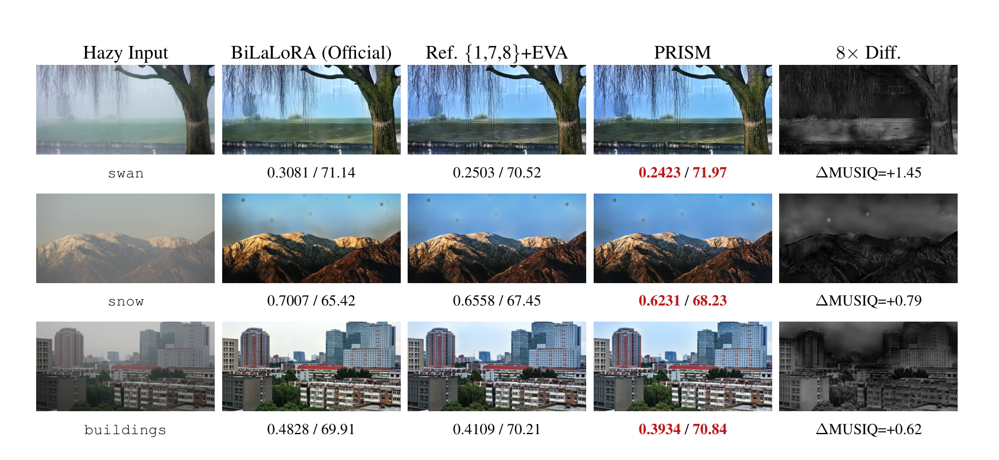

# PRISM: Perceptually Feasible Low-Rank Layer Allocation via Decoupled Probing for Real-World Image Dehazing

**PRISM** (*Perceptually Regulated Iso-budget Snapshot Masking*) addresses the **semantic--perceptual mismatch** and **cross-seed bi-level gating drift** in unpaired parameter-efficient adaptation of pretrained dehazing backbones. By uniting unfolded convolutional Explained Variance Adaptation (**Conv-EVA**) with gradient-free enumeration over equal-capacity bottleneck subsets on a shared epoch-5 snapshot, PRISM decouples discrete layer selection from gradient backpropagation without modifying the downstream CLIP Haze-to-Clear (H2C) fine-tuning loss.

> 📄 **Paper (PDF)**: **[PRISM_Submission_EN.pdf](paper/PRISM_Submission_EN.pdf)** &nbsp;|&nbsp; **LaTeX Source**: [`paper/en/`](paper/en/)

<p align="center">
  
</p>

## Key Highlights

1. **Semantic--Perceptual Mismatch & Iso-Budget Scoping**: Probing all $\binom{8}{3}=56$ Level-3 bottleneck subsets (plus 1,232 cross-domain and 16-block sensitivity probes) reveals that relying solely on crop-level CLIP H2C loss fails on two fronts: unrestricted 16-block bi-level gating drifts across seeds into narrow encoder blocks (collapsing capacity to 82,947 or 55,299 params), while unconstrained bottleneck minimization selects shallow-inclusive `{5,6,8}`, degrading whole-image MUSIQ via sky--facade over-enhancement.
2. **Decoupled Perceptually Regulated Selection**: After Conv-EVA initialization and a 5-epoch 16-block warm-up ($\theta_5$), PRISM freezes gradients and enumerates the 56 equal-capacity Level-3 subsets under a whole-image MUSIQ guardrail $\tau = p(\mathcal{S}_{\mathrm{ref}})$, consistently locking `{6,7,8}` across all 3 random seeds (`3407` / `3408` / `3409`, reducing RTTS-128 FADE std from `0.0474` under restricted gating to **`0.0053`**) without changing the H2C training objective.
3. **Zero Added Inference Overhead**: Phase-2 fine-tuning updates only **3.03%** (`110,595`) parameters across the 3 selected blocks before lossless linear reparameterization $W' = W + \gamma g\,\mathcal{R}^{-1}(BA)$ folds them back into frozen `DEA-Net` (`3,653,377` parameters, **0 extra parameters, 0 extra FLOPs**, `0.0` float diff and `0 LSB` PNG diff on smoke verification).

<p align="center">
  
</p>

<p align="center">
  
</p>

## Quantitative Results

Unified lossless uint8 PNG evaluation across **RTTS ($n=4{,}322$)** and **Fattal ($n=31$)** (3-seed mean $\pm$ std over seeds `3407`, `3408`, `3409`):

| Method | RTTS FADE ↓ | RTTS BIQME ↑ | RTTS Entropy ↑ | RTTS MUSIQ ↑ | Fattal FADE ↓ | Fattal BIQME ↑ | Fattal MUSIQ ↑ |
|---|---:|---:|---:|---:|---:|---:|---:|
| BiLaLoRA (CVPR 2026)† | 0.752 | 0.611 | 7.576 | 61.77 | 0.281 | 0.607 | 67.92 |
| BiLaLoRA (Official Merged) | 0.7544 | 0.6107 | 7.5757 | 61.77 | 0.3070 | 0.6206 | **68.59** |
| Ref. `{1,7,8}` + Conv-EVA | 0.7172 ± 0.0078 | 0.6112 ± 0.0008 | 7.5785 ± 0.0021 | 61.65 ± 0.14 | 0.2847 ± 0.0009 | 0.6217 ± 0.0004 | 67.71 ± 0.09 |
| **PRISM `{6,7,8}` (Ours)** | **0.6241 ± 0.0055** | **0.6191 ± 0.0002** | **7.5799 ± 0.0024** | **61.79 ± 0.05** | **0.2714 ± 0.0019** | **0.6248 ± 0.0003** | 68.02 ± 0.01 |

- **RTTS ($n=4{,}322$)**: Cuts FADE by **13.0%** over matched-protocol Ref. `{1,7,8}` + Conv-EVA (99.7% per-image win rate across 2,000 paired bootstrap resamples, seed `20261115`) and **17.0%** over reported BiLaLoRA while leading BIQME, Entropy, and MUSIQ.
- **Dense-Haze ($n=55$, zero-shot)**: Improves PSNR by **+0.2914 dB** (`11.9296 → 12.2210`) and reduces FADE by **15.1%** (`0.7475 → 0.6343`) over Ref. `{1,7,8}` + Conv-EVA, with transparent perception--distortion trade-offs (`MUSIQ 54.80 → 53.58`).

<p align="center">
  
</p>

## Repository Structure

```text
PRISM/
├── dehaze.py                         # Zero-dependency inference CLI (CUDA/CPU; no CLIP or pyiqa needed)
├── requirements.txt                  # Python dependencies
├── DEAmodel/                         # Clean DEA-Net backbone and LoRA/CGA module definitions
├── checkpoints/                      # Losslessly merged deployment weights (seed 3407/3408/3409), merge audit, & smoke check
├── prism/                            # Core training, Conv-EVA calibration, epoch-5 probing, & linear merging scripts
├── evaluation/                       # Portable MUSIQ evaluator, main-table bootstrap stats, & snapshot probe logs
├── paper/                            # PRISM_Submission_EN.pdf and full LaTeX source (paper/en/)
└── assets/                           # Architecture, motivation, landscape, and qualitative figures
```

## Quick Start (Zero-Overhead Inference)

### 1. Install Dependencies
```bash
pip install -r requirements.txt
```

### 2. Run Inference
The released checkpoints have already been linearly reparameterized back into vanilla `DEA-Net` kernels (`3,653,377` parameters):
```bash
# GPU inference (recommended)
python dehaze.py --weights checkpoints/prism_seed3407.pth --input checkpoints/smoke_input --output outputs/demo --device cuda

# CPU inference
python dehaze.py --weights checkpoints/prism_seed3407.pth --input checkpoints/smoke_input --output outputs/demo --device cpu
```

## Core Pipeline Modules

- `prism/calibrate_eva.py`: Collects unfolded sliding-window patch activations $X$ ($N = 24{,}576$ rows across 32 training images) for all 16 candidate blocks and computes centered covariance eigendecompositions $\Sigma = V \Lambda V^\top$ for zero-perturbation Conv-EVA initialization ($A_0 = D V_d^\top, B_0 = 0$).
- `prism/quality_select_probe.py`: Evaluates all $\binom{8}{3}=56$ equal-capacity Level-3 subsets on $\mathcal{D}_{\mathrm{sel}}$ without gradients at epoch-5 snapshot $\theta_5$, applying the whole-image MUSIQ guardrail $p(\mathcal{S}) \ge p(\mathcal{S}_{\mathrm{ref}})$ to isolate `{6,7,8}`.
- `prism/fixed_selection_switch.py` / `prism/BiLaLoRA_Train.py`: Restores the 15 trainable tensors of `{6,7,8}` from $\theta_5$, drops the remaining 13 candidate blocks and architecture optimizer, resets a common phase-2 seed with a fresh Adam optimizer, and fine-tunes for 25 epochs under the unmodified H2C objective.
- `prism/merge_quality_deployment.py`: Linearly folds the 6 LoRA branches into the base `nn.Conv2d` weights via $W' = W + \gamma g\,\mathcal{R}^{-1}(BA)$ and verifies `raw_max_abs_error == 0.0` and `PNG_max_LSB_error == 0` in `checkpoints/merge_audit.json`.

## License

This project is released under the [MIT License](LICENSE).
