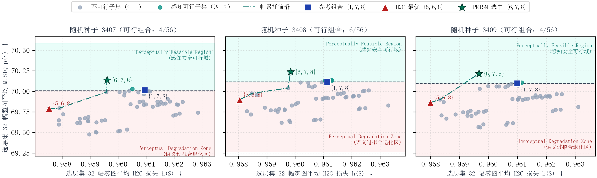
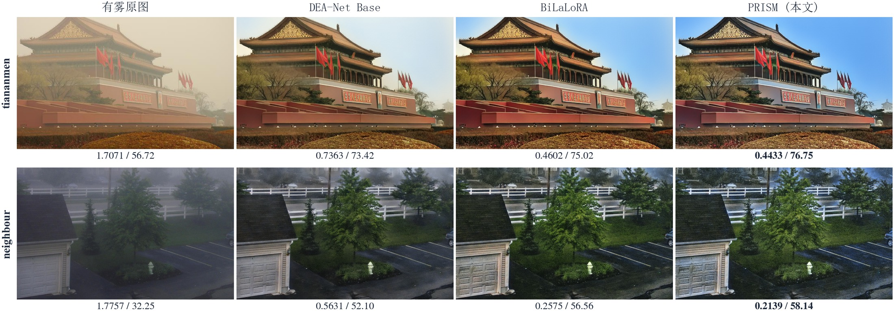

# PRISM: Perceptually Regulated Iso-budget Snapshot Masking for Unsupervised Real-World Image Dehazing

**PRISM**（感知可行域引导的低秩层分配——面向真实图像去雾的评训分离适配）针对无配对真实图像去雾中的“语义—感知失配”与双层连续门控高方差问题，提出将卷积激活解释方差对齐（**Conv-EVA**）与第 5 轮共享快照上的无梯度 56 组合前向可行域筛选相结合，将适配层位置决策与反向传播彻底解耦。

> 📄 **English Academic Paper (PDF)**: **[PRISM_Submission_EN.pdf](paper/PRISM_Submission_EN.pdf)** （完整纯英文 LaTeX 源码与图表位于 [`paper/en/`](paper/en/)）

<p align="center">
  
</p>

## 核心亮点

1. **揭示语义—感知失配机理**：在全部 $\binom{8}{3}=56$ 个等容量三层子集上首次完整刻画了“CLIP H2C 语义损失 — 整图 MUSIQ 感知质量”二维景观，证实纯最小化 H2C 会系统性坠入浅层过增强退化区 `{5,6,8}`。
2. **评训分离的感知安全筛选**：利用 Conv-EVA 构建稳定第 5 轮共享快照，以参考组合 `{1,7,8}` 的整图 MUSIQ 为安全护栏 $\tau$，在无梯度前向模式下于全部 3 个独立随机种子（3407 / 3408 / 3409）下一致锁定帕累托最优深层瓶颈子集 `{6,7,8}`，将跨种子标准差降低近一个数量级，且**不改动下游纯 H2C 训练损失**。
3. **零额外推理开销**：仅微调 3.03%（110,595）参数，训练结束后通过线性重参数化 $W' = W + \gamma g \mathcal{R}^{-1}(BA)$ 无损并入原 `DEA-Net` 骨干（3,653,377 参数，**0 额外参数、0 额外 FLOPs**，合并前后 PNG 像素误差 `0 LSB`）。

<p align="center">
  
</p>

## 主要定量结果

| 方法 | RTTS (n=4,322) FADE↓ | RTTS BIQME↑ | RTTS MUSIQ↑ | Fattal (n=31) FADE↓ | Fattal BIQME↑ |
|---|---:|---:|---:|---:|---:|
| BiLaLoRA (CVPR 2026)† | 0.752 | 0.611 | 61.77 | 0.281 | 0.607 |
| 参考位置 `{1,7,8}` + Conv-EVA | 0.7172 ± 0.0078 | 0.6112 ± 0.0008 | 61.65 ± 0.14 | 0.2847 ± 0.0009 | 0.6217 ± 0.0004 |
| **PRISM `{6,7,8}` (Ours)** | **0.6241 ± 0.0055** | **0.6191 ± 0.0002** | **61.79 ± 0.05** | **0.2714 ± 0.0019** | **0.6248 ± 0.0003** |

- **Course-10 课程指定 10 图实测**：在全部 10 幅图像上取得 **10/10 逐图 FADE 最优**（均值由原图 `1.0894` / Base `0.4163` / BiLaLoRA `0.2418` 降至 **`0.2225`**），平均 MUSIQ 达 **`68.26`**。

<p align="center">
  
</p>

## 仓库目录结构

```text
PRISM/
├── dehaze.py                   # 零依赖推理脚本（无需 CLIP / pyiqa，支持 CUDA/CPU）
├── DEAmodel/                   # 纯净 DEA-Net 推理架构定义
├── checkpoints/                # 3 个独立种子的无损合并部署权重 (prism_seed3407/3408/3409.pth) 与冒烟样例
├── prism/                      # PRISM 核心算法源码（Conv-EVA 初始化、56 组合快照筛选、无损重参数化合并）
├── evaluation/                 # MUSIQ 评测脚本、30,471 条评测汇总 JSON 与 56 组合探针数据
├── paper/                      # 英文投稿论文 PRISM_Submission_EN.pdf、纯英文 LaTeX 源码 (en/) 与 Word 报告构建脚本
└── assets/                     # 架构图、景观图与定性对比图
```

## 快速开始（单命令去雾推理）

### 1. 安装依赖
```bash
pip install -r requirements.txt
```

### 2. 运行零额外开销推理
推理权重已通过线性重参数化无损并入原生 `DEA-Net`，无需下载 CLIP 或 MUSIQ：
```bash
# GPU 推理（推荐）
python dehaze.py --weights checkpoints/prism_seed3407.pth --input checkpoints/smoke_input --output outputs/demo --device cuda

# CPU 推理
python dehaze.py --weights checkpoints/prism_seed3407.pth --input checkpoints/smoke_input --output outputs/demo --device cpu
```

## 核心算法复现说明

- `prism/calibrate_eva.py`：提取 32 幅训练雾图在候选 3×3 卷积上的滑动窗口激活矩阵 $X$，执行均值中心化协方差分解 $\Sigma = V \Lambda V^\top$ 与 Conv-EVA 初始化。
- `prism/quality_select_probe.py`：在第 5 轮共享快照 $\theta_5$ 处遍历全部 56 种等容量子集，在感知安全可行域 $p(\mathcal{S}) \ge p(\mathcal{S}_{\text{ref}})$ 内锁定帕累托最优 `{6,7,8}`。
- `prism/fixed_selection_switch.py`：提取选定子集已训张量、卸载其余旁路并严格恢复四重 RNG 状态以执行后续 25 轮纯 H2C 精调。
- `prism/merge_quality_deployment.py`：执行式 $W' = W + \gamma g \mathcal{R}^{-1}(BA)$ 线性重参数化合并并校验 `PNG_max_LSB_error == 0`。

## 许可证

本项目采用 [MIT License](LICENSE) 开源发布。
